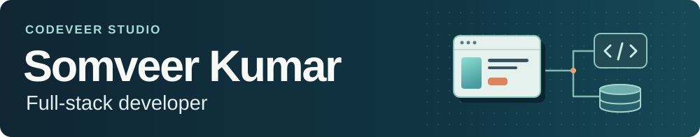
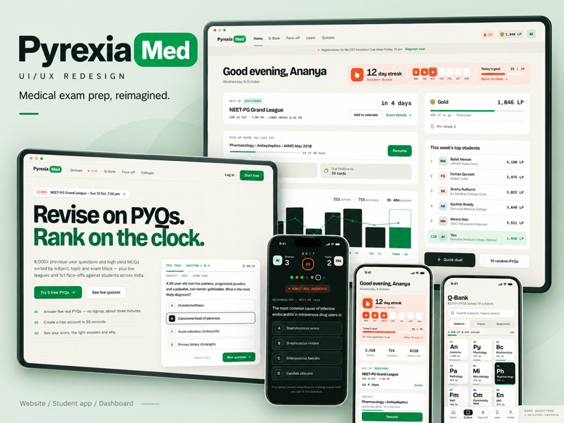
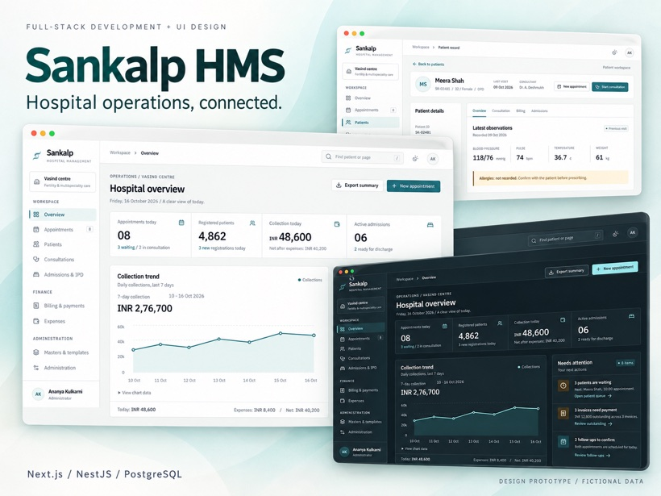
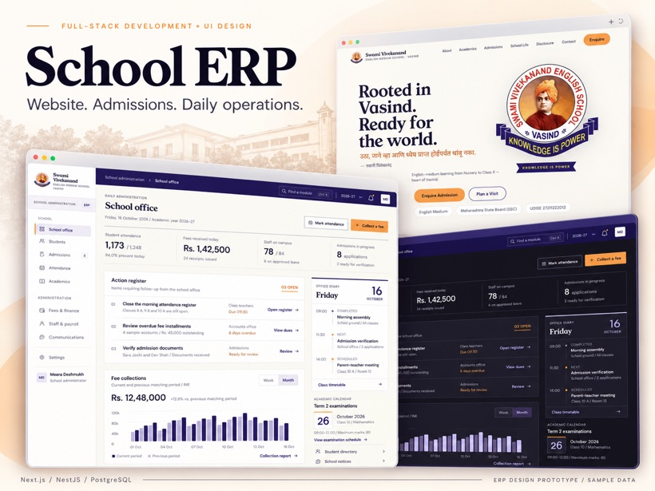
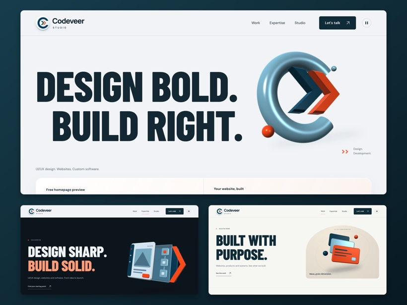

<h1></h1>

I design and build web applications at [Codeveer Studio](https://codeveer.in/). My work spans the screens people use and the APIs and databases behind them. Recent projects include a medical exam platform, hospital operations software and a school admissions system.

[Portfolio](https://somveerkumar.dev/) &nbsp; / &nbsp; [Upwork](https://www.upwork.com/freelancers/~01f864033fa8e2b439) &nbsp; / &nbsp; [Client reviews](https://contra.com/somveerkumar/reviews) &nbsp; / &nbsp; [Email](mailto:work.somveerk@gmail.com)

## Tools and technologies

<table>
<tr>
<th align="left" width="33%">Frontend</th>
<th align="left" width="34%">Backend and data</th>
<th align="left" width="33%">Automation and delivery</th>
</tr>
<tr>
<td valign="top"> React, Next.js, TypeScript, Tailwind CSS, Astro</td>
<td valign="top"> Node.js, NestJS, PostgreSQL, Prisma, Supabase, Redis</td>
<td valign="top"> Python, Docker, Git, GitHub</td>
</tr>
</table>

## Selected work

<table>
<tr>
<td width="50%" valign="top">

<h3>PyrexiaMed</h3>

I designed and built a medical exam platform where students can practice questions, turn bookmarks into flashcards and compete in live quizzes. The server enforces answer deadlines and calculates scores.

Next.js, PostgreSQL, Supabase, Socket.IO, Redis

<a href="https://pyrexiamed.com/">Live platform</a> &nbsp; / &nbsp; <a href="https://contra.com/p/6rsl6boW-pyrexia-med-or-full-stack-medical-exam-platform">Case study</a>

</td>
<td width="50%" valign="top">

<h3>Sankalp HMS</h3>

I built the application that links appointments, consultations, inpatient stays and billing to a single patient record. The API checks that a bill belongs to the right patient and recalculates the total.

Next.js, NestJS, PostgreSQL, Prisma, OpenAPI

<a href="https://contra.com/p/72cl6bAm-sankalp-hms-or-full-stack-hospital-management">Case study and interface prototype</a>

</td>
</tr>
<tr>
<td width="50%" valign="top">

<h3>School ERP</h3>

I built the public school website and the staff application for admissions, student records and fees. Approving an application creates the student, academic and fee records in one database transaction.

React, Next.js, NestJS, Prisma, PostgreSQL

<a href="https://swamivivekanandvasind.in/">School website</a> &nbsp; / &nbsp; <a href="https://contra.com/p/3qULAmrb-school-erp-or-website-admissions-and-school-operations">ERP case study</a>

</td>
<td width="50%" valign="top">

<h3>Codeveer Studio</h3>

I designed and developed the studio website with a custom WebGL sculpture. Astro serves the content as static HTML. The artwork responds to the pointer, pauses offscreen and has a fallback when WebGL is unavailable.

Astro, JavaScript, CSS, WebGL, GLSL

<a href="https://codeveer.in/">Live website</a> &nbsp; / &nbsp; <a href="https://contra.com/p/ebOZcq7P-codeveer-studio-or-interactive-3-d-website">Case study</a>

</td>
</tr>
</table>

The PyrexiaMed cover shows the design stage. The hospital and school ERP screens use fictional records from their interface prototypes.

## More projects

| Project | What I worked on |
| --- | --- |
| [Shopmayven](https://github.com/mayvenmegan/shopmayven) | A Next.js product discovery interface with Algolia search and filters for brand values. |
| [Tiles](https://tiles-pattern-generator.netlify.app/) | A browser tool for inspecting image seams. Drop in a local image and adjust the repeat scale. |
| [Sumz](https://github.com/SomveerKr/summize-ai-article-summarizer) | A React interface for an article summarization API, with saved results in browser storage. |
| [Nike-inspired catalogue](https://nike-store-e-com.netlify.app/) | An independent React storefront project with footwear collections and an editorial carousel. |

I've completed 23+ freelance software projects through Replit and hold the Replit Expert badge on [Contra](https://contra.com/somveerkumar). For a new build or a feature in an existing app, [send me the workflow you want to improve](mailto:work.somveerk@gmail.com).
